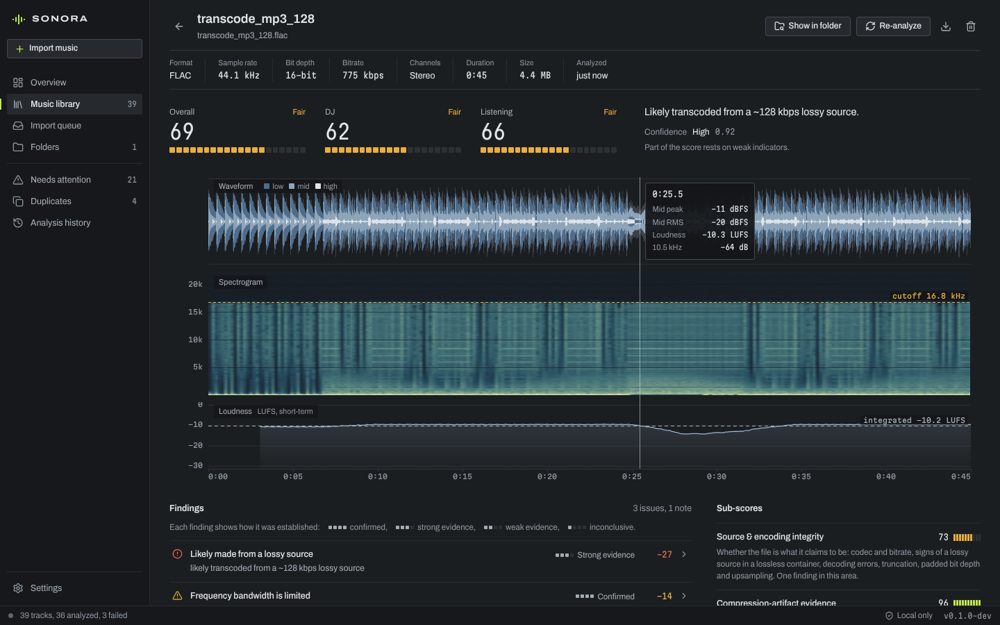

# SONORA

SONORA is a desktop app for macOS and Windows that checks the technical
quality of a music library. It analyzes every track on your computer and
gives each one three scores: **overall** technical quality, **DJ**
suitability and **listening** suitability. Every deduction is explained by
a finding that says what was measured, why it matters and how reliable the
conclusion is.

It finds clipping in lossless files (including clipping that was
normalised away) and overs in lossy ones, lossy files posing as lossless,
"320 kbps" MP3s made from 128 kbps ones, spliced sources, truncated or
damaged files, dropouts, zero-filled endings from incomplete downloads,
phase problems, DC offset, padded bit depth, upsampling, and duplicates
across formats. When the evidence is inconclusive it says so instead of
guessing.



## Privacy

SONORA is local-first. Analysis runs on your computer, and audio, results
and file paths never leave it. The app makes no network requests: no
uploads, analytics, telemetry or update checks. The desktop build's
content-security policy blocks remote content. Your audio files are only
ever read, never modified, moved or deleted. "Remove from library" removes
SONORA's index entry only.

## Features

- **Import**: single files, multiple files, folders (scanned recursively)
  and drag and drop. Rescan library folders at any time or at launch.
  Unchanged files are skipped by size and modification time. Moved or
  renamed files are relinked by content, so their results are kept. Deleted
  files are marked missing, and a reconnected drive restores them.
- **Formats**: WAV, AIFF and FLAC are decoded natively, with FLAC MD5
  verification. MP3, AAC/M4A, ALAC, Ogg Vorbis, Opus and others go through
  a bundled FFmpeg. Formats are identified from the file content, not the
  extension.
- **Background analysis**: a bounded worker pool with live progress, pause,
  resume, cancel and retry of failed files. A scan interrupted by a crash
  or by quitting continues on the next launch; a cancelled one does not.
  The interface stays responsive throughout. Only one copy of the app runs
  at a time: opening it again brings the running window to the front.
- **Scores and findings**: three scores, five sub-scores, a confidence
  estimate with reasons, a verdict, and findings graded by evidence:
  confirmed, strong, weak or inconclusive. See [docs/SCORING.md](docs/SCORING.md).
- **Track analysis**: a three-band waveform with clipping and over markers,
  a spectrogram with the detected cutoff, and short-term loudness on one
  time axis with a shared cursor. Also the average spectrum (both channels
  and the side signal),
  energy by band, and full technical measurements (EBU R128 loudness, true
  peak, crest factor, PLR, stereo, silence and integrity).
- **Library**: a virtualized table for large libraries, with search, sort,
  filters (score range, format, issue, status), multi-select, keyboard
  navigation, a details panel, CSV export, re-analysis, Reveal in Finder or
  File Explorer, and removal from the library.
- **Needs attention**: problem tracks grouped by clipping, lossy source, low
  bitrate, integrity, weak-evidence issues, failures and missing files.
- **Duplicates**: identical files (same file hash), identical audio in
  different files (same decoded-audio hash), and the same recording in
  another encoding or an alternate edit (acoustic fingerprint). Groups can
  be compared side by side. Nothing is grouped by title, and nothing is
  ever deleted automatically.
- **History**: every scan with its summary and results.
- **Settings**: parallel workers, longest file analyzed, rescan behaviour,
  hidden files and symlinks, default score view, database location and
  backup, cache management, FFmpeg status, version and privacy
  information.
- **Accessibility**: full keyboard use (table, menus, dialogs, tabs, chart
  cursor), visible focus, labels and tooltips, confirmation before
  destructive actions, and reduced-motion support.

## Getting started

Requirements:

- [Rust](https://rustup.rs) stable 1.90 or newer.
- Node.js 22.18 or newer.
- On macOS, the Xcode Command Line Tools.
- On Windows, the MSVC Build Tools and WebView2.

[docs/BUILDING.md](docs/BUILDING.md) has the details.

```sh
npm install
npm run app:dev        # desktop app (Tauri) with hot reload
```

Or work in a browser against the same core:

```sh
npm run dev:web        # interface on http://localhost:1420, core on 127.0.0.1:4317
```

The browser cannot see file paths, so it asks you to type the paths of
folders to import. Native pickers and drag and drop need the desktop app.
Reveal works in both: in the browser, the dev bridge opens the file manager
on the machine it runs on.

For a demo library, run `npm run fixtures` and import `fixtures/library`.
It holds 39 generated files: 36 tracks (clean masters in several formats,
lossy encodes, three transcodes into lossless containers and a fake 320,
clipping, dropouts, truncation, duplicates, an alternate edit and more) and
3 broken files. 26 of them need FFmpeg to be generated; without it you get
the other 13.

## Building installers

```sh
npm run app:build
```

This builds for the current machine and bundles FFmpeg. It produces
`SONORA.app` and a `.dmg` on macOS, and an NSIS `.exe` and an `.msi` on
Windows, in `src-tauri/target/release/bundle/`. Build each platform on that
platform. Cross-compiling is not supported, and CI uses one runner per OS.

CI also builds the installers for macOS (Apple silicon and Intel) and
Windows x64 on every push to `main`. Download them from the *Artifacts*
section of a CI run on GitHub's Actions tab. GitHub keeps them for 14 days
and asks you to sign in to download.

Signing and notarization are optional: on macOS through environment
variables, on Windows through Tauri configuration (a certificate thumbprint
or a sign command). See [docs/BUILDING.md](docs/BUILDING.md#signing-and-notarization)
for targets, universal macOS builds, signing, and the FFmpeg licensing
notes. The app runs on macOS 13 or later and on Windows 10 and 11.

## Architecture

```
┌──────────────────────── Interface (src/) ────────────────────────┐
│ React 19 + TypeScript (strict), Vite, uPlot + canvas, Lucide     │
│ views → typed API client → Bridge                                │
└──────────────┬──────────────────────────────────┬────────────────┘
      Tauri IPC (desktop)                HTTP + SSE (browser dev, E2E)
               │                                  │
   src-tauri/  thin Tauri 2 shell       crates/sonora-devserver
   (one command + an event channel,     (localhost only, same API)
    dialogs, opener, FFmpeg sidecar)              │
               └──────────────┬───────────────────┘
                   crates/sonora-core: library core
                   SQLite (WAL), indexer, scan manager (bounded
                   worker pool, DB-backed queue), duplicates,
                   export, settings, JSON API, events, logs
                              │
                   crates/sonora-engine: analysis engine
                   decoders (native WAV/AIFF/FLAC, FFmpeg pipe),
                   one-pass streaming meters, assessment rules,
                   scoring, fingerprints
```

| Part | Responsibility |
| --- | --- |
| `crates/sonora-engine` | Decoding, metadata, DSP (K-weighting, true-peak interpolation, FFT), measurements, findings and scores. Std-only Rust. |
| `crates/sonora-core` | Library database and migrations, incremental indexing, background scans, duplicate detection, CSV export, settings, the JSON API used by both shells, structured logs. |
| `crates/sonora-json` | A small JSON value type, parser and serializer. |
| `crates/sonora-cli` | `sonora analyze / measure / compare / fixtures`, for development and calibration. |
| `crates/sonora-devserver` | Serves the built interface and the core API over HTTP and Server-Sent Events on 127.0.0.1, for browser development and end-to-end tests. Rejects other hosts and origins. |
| `src-tauri` | Desktop shell: opens the core in the local app data folder, forwards `sonora_call` to it on a blocking thread, relays events, registers the single-instance, dialog and opener plugins and bundles FFmpeg. |
| `src/` | The interface: `api/` (bridges, typed client), `state/` (core context, imports, toasts, track actions), `views/`, `components/`, `charts/`, `lib/` (formatting, scores, routing, visual decoding), `styles/` (design tokens). |

**Design decisions and trade-offs:**

- **The analysis engine is native Rust, not a Python sidecar.** It runs in
  the same process as the library core. That avoids bundling a Python
  runtime (hundreds of MB, plus code signing and notarization of a second
  runtime on macOS), a second IPC layer and cold-start costs. Analysis
  takes about 2.5 s for a 6-minute WAV on one core. The cost is more DSP
  code to write and test: K-weighting, true peak and FFT are implemented
  and verified against references in the test suite.
- **The workspace uses the standard library only**, apart from the
  system's SQLite. It builds offline and stays small. The desktop shell
  links its own bundled SQLite (`libsqlite3-sys`), so every platform runs
  the same version.
- **FFmpeg runs as a separate program** for lossy formats, streaming WAV
  through a pipe. This isolates decoder crashes, keeps memory bounded and
  makes timeouts possible. Native decoders cover the lossless formats that
  need sample-exact checks.
- **SQLite with WAL** uses one writer connection and a read connection, so
  queries never wait for a scan. The scan queue lives in the database, so
  a crash or quit loses nothing.
- **Visualization data is small**: about 100 kB per track, stored with the
  analysis and clearable in Settings. Charts never re-decode audio.

## Testing

```sh
npm run test:rust          # 158 Rust tests: DSP, decoders, scoring, indexing, scan queue, database, API
npm run test:unit          # 20 interface unit tests (formatting, scores, routing, paths, visual decoding)
npm run typecheck          # strict TypeScript, including tests and e2e
npm run build && npm run test:e2e   # 13 Playwright tests: real interface + real core on a generated corpus
```

One Rust test is Unix-only (symlink loops), so Windows runs 157. The
FFmpeg-based checks are skipped with a note when FFmpeg is not installed.

The end-to-end suite imports the corpus through the interface and
exercises background analysis, search, sort, filter, keyboard navigation
(including Delete acting on the track the details panel shows), the track
analysis view and its charts, Needs attention and its tabs, duplicates and
fingerprint comparison, CSV export, removal with confirmation (and checks
the file is untouched), folder rescans, settings persistence, history and
keyboard use of menus.

## Troubleshooting

- **MP3, AAC, Ogg or Opus files fail with "FFmpeg is required".** Release
  builds include FFmpeg. In development, install it (`brew install ffmpeg`
  or `winget install Gyan.FFmpeg`) or point `SONORA_FFMPEG` at an `ffmpeg`
  binary. Settings → Decoding shows what SONORA found, with a *Check again*
  button.
- **macOS says the app can't be opened.** Unsigned builds need
  *Open Anyway* in System Settings → Privacy & Security once.
- **Windows says "Windows protected your PC".** SmartScreen warns about
  unsigned installers. Choose *More info*, then *Run anyway*.
- **A folder shows as unavailable.** Its drive is disconnected. Its tracks
  keep their results and are restored when the drive returns and the
  folder is rescanned.
- **Logs** are JSON lines in `logs/sonora.log` in the app data folder,
  rotated at 5 MB. Settings → About shows the folder.

There are more answers in [docs/BUILDING.md](docs/BUILDING.md#troubleshooting).

## Status and known limitations

- The installers are not signed, so macOS and Windows warn before the first
  launch (see Troubleshooting). Automated tests cover the core, the engine,
  the dev bridge and the interface, but not the packaged desktop app: CI
  builds the installers without launching them.
- Mains hum, clicks and crackle, and wow and flutter are not detected.
  High-bitrate lossy sources (AAC 256, MP3 V0 or 320) in lossless
  containers are usually inconclusive by nature.
  [docs/SCORING.md](docs/SCORING.md#what-can-and-cannot-be-detected) has
  the full list.
- Pause takes effect between files: files already being analyzed finish
  first.
- Only the dark theme exists.
- Dependencies are pinned to minor versions, but no lockfiles are committed
  yet. Commit the `package-lock.json` and `src-tauri/Cargo.lock` that the
  first install and build create.
- No license has been chosen for the project yet. Add one before
  distributing builds, and see `src-tauri/binaries/README.md` for FFmpeg's
  licence terms.
