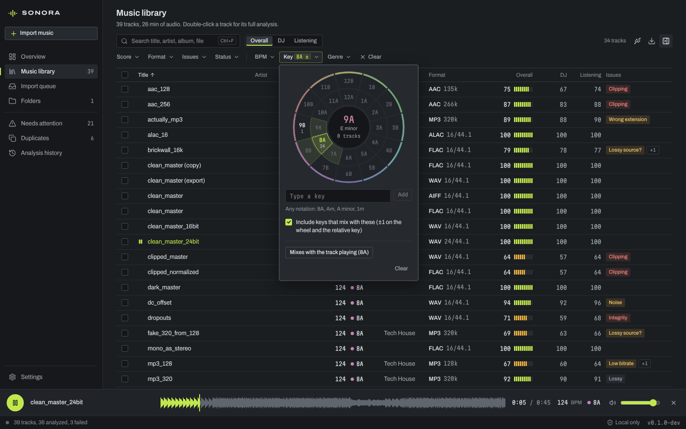

# DJ features

SONORA detects the tempo and key of every track, finds genres, lets you
listen, and exports tracks as files that DJ software and players read with
their tempo, key, genre and artwork. Everything runs on your computer. The
only exception is the optional Discogs genre lookup, which runs only when you
start it (see [Genres](#genres)).

- [Tempo](#tempo)
- [Key](#key)
- [Genres](#genres)
- [Corrections](#corrections)
- [Filtering and sorting](#filtering-and-sorting)
- [Export for DJ software](#export-for-dj-software)
- [Listening](#listening)
- [Limits](#limits)

## Tempo

Tempo detection is part of the normal analysis. Each track is decoded once,
and the tempo, the key and all quality measurements come from that one pass.

How it works:

1. An onset envelope is built from spectral flux: the increase in energy
   across log-spaced bands (four per octave, 23 ms frames).
2. Autocorrelation of that envelope, combined over the beat's multiples,
   scores every tempo from 40 to 250 BPM.
3. A check that folds the envelope at the candidate period catches
   half-time readings (for example, drum & bass read as 87 instead of 174).
4. A refinement over the whole track pins a steady tempo to a thousandth
   of a BPM. Most dance music is produced at whole-number tempos, so a
   tempo within 0.1 BPM of a whole number that fits it as well is set to
   that number.
5. Local tempos in 20-second windows show whether the tempo drifts or
   changes. Such tracks are flagged as **variable** (shown as `124~`).

Material without a pulse (ambient, spoken word, silence, noise) gets no
tempo instead of a guess.

**BPM range** (Settings → Tempo and key): tempos are reported within one
octave, so every track has exactly one reading. A drum & bass track reads
174 in 88–175 and 87 in 70–140. The default 70–180 suits most libraries.
Changing the range updates every track immediately, with no re-analysis.
Tempos you typed yourself are kept as typed.

## Key

1. The spectrum of every ~0.37-second frame (50 Hz to 3 kHz) is searched
   for tonal peaks: peaks that stand 12 dB above their surroundings. The
   power spectra of the two channels are added, so a channel with inverted
   polarity cannot cancel the other.
2. Each peak adds to a pitch histogram with ten bins per semitone. Every
   frame counts equally, so loud drops do not drown out quiet harmonic
   passages, and drums (broadband, with few clear peaks) count little.
3. The tuning reference is estimated from where the peaks sit within the
   semitone, so tracks tuned to A = 432 Hz or off-speed vinyl rips are
   read correctly. The track page shows the tuning.
4. The histogram is folded into 12 pitch classes. The bass line (below
   150 Hz) is counted separately and added at half weight, because it tends
   to sit on the tonic and the chord roots.
5. The profile is correlated with the Krumhansl–Kessler profiles of all 24
   keys, extended with the harmonics real notes produce. The best match is
   the key; the confidence and the runner-up are shown too.
6. Keys of 10-second segments show whether one key holds through the track.

Tracks with too little tonal material (under six seconds of it) get no key.

### Notations

Choose the notation in Settings → Tempo and key. It applies to lists,
filters, the player and the default for exports.

| Key | Camelot | Open Key | Musical | Sharps | Flats |
| --- | --- | --- | --- | --- | --- |
| A minor | 8A | 1m | Am | Am | Am |
| C major | 8B | 1d | C | C | C |
| E minor | 9A | 2m | Em | Em | Em |
| F♯ minor | 11A | 4m | F♯m | F♯m | G♭m |
| A♭ minor | 1A | 6m | A♭m | G♯m | A♭m |
| D♭ major | 3B | 8d | D♭ | C♯ | D♭ |

*Musical* uses the Camelot wheel's own spellings (flats, except F♯).
Wherever you can type a key (filters, corrections), any notation works:
`8A`, `08a`, `1m`, `Am`, `A min`, `A minor`, `G#m`, `G♯m`, `Abm`.

### Harmonic mixing

On the Camelot wheel, neighbours mix: the same number in the other letter
(the relative major or minor), and one step either way in the same letter.
8A mixes with 8B, 7A and 9A. The key filter can include these neighbours
for you, and the colour dot next to each key follows its place on the
wheel, so neighbouring keys have neighbouring colours.

## Genres

A track's genre comes from, in order:

1. **Your correction**, or a genre you looked up on Discogs.
2. **The file's genre tag.**
3. **The folder name**, if you turn this on in Settings → Genres:
   - *Top folder*: the first folder inside the library folder. In
     `Music/House/Artist/track.mp3`, the genre is House.
   - *Containing folder*: the folder the file is in (never the library
     folder itself).

### Discogs (optional)

[Discogs](https://www.discogs.com) knows the genres and styles of most
released dance music. To use it:

1. Create a free Discogs account, then a personal access token under
   Discogs → Settings → Developers.
2. Paste the token in SONORA under Settings → Genres → Discogs genre lookup.
   SONORA tests it right away. The token is kept in the library database on
   your computer and is never shown again.
3. Select tracks, then choose **Look up genres on Discogs** in the details
   panel (or **Discogs** for one track). SONORA asks first and tells you how
   long it will take.

What is sent: for each chosen track, its artist and title (from the tags, or
from an `Artist - Title` file name), your token, and SONORA's name and
version, over HTTPS to `api.discogs.com`. Nothing else: no audio, file names
or paths. Requests are spaced 1.1 seconds apart, below Discogs' limit of 60
a minute, and go through the system's `curl` (built into macOS and Windows 10
and 11), so SONORA itself contains no network code.

The genre chosen is the style most of the artist's matching releases agree
on (for example *Tech House*), or the broad genre when a release lists no
style. The release page is linked next to the genre, and the data is
credited to Discogs, as the Discogs API terms require. Tracks that already
have a genre are skipped unless you choose to replace their genres.

This application uses Discogs' API but is not affiliated with, sponsored or
endorsed by Discogs. "Discogs" is a trademark of Zink Media, LLC.

## Corrections

**Edit…** in the details panel, the track page or the selection bar opens a
dialog for tempo, key and genre:

- **Tempo**: type it, or use ×2 and ÷2 to fix half-time and double-time
  readings. With several tracks selected, ×2 and ÷2 apply to each track's
  own tempo.
- **Key**: type it in any notation, or pick it on the wheel.
- **Genre**: type it, with the genres already in the library as
  suggestions.

Corrections are stored in SONORA's library database. **Your audio files are
never changed**; exports write the corrected values into the copies they
make. **Reset to detected** removes the corrections (and Discogs genres) of
the selected tracks.

## Filtering and sorting

The library has three DJ filters next to the quality filters:

- **BPM**: a range, optionally also matching half and double the range (so
  70–75 also finds 140–150). While a track plays, ±2 %, ±4 % and ±8 %
  around its tempo are one click away.
- **Key**: pick keys on the Camelot wheel, or type them. *Include keys that
  mix with these* adds the harmonic neighbours. While a track plays,
  *Mixes with the track playing* selects its key and neighbours.
- **Genre**: the genres in the library, with their counts.

The BPM, Key and Genre columns sort by tempo, by position on the wheel
(1A, 1B, 2A, …) and alphabetically.

## Export for DJ software

**Export for DJ software** (in the toolbar, the selection bar, the details
panel and the track page) writes new files to a folder you choose.

| Format | What it is for |
| --- | --- |
| **AIFF** (recommended) | Lossless, with tempo, key, genre and artwork that rekordbox, Serato, Traktor, Engine DJ and CDJs all read. |
| **WAV** | Lossless and plays everywhere, but some players and older CDJs ignore tags in WAV files. SONORA writes both a RIFF INFO list and an ID3 chunk. |
| **MP3 320** | Plays on every device, including old players and car stereos. Lossless sources lose some quality. MP3 sources are copied frame for frame, without a second encoding. |

Quality for AIFF and WAV:

- **16-bit / 44.1 kHz** (default): CD quality, readable by every CDJ,
  controller and USB player.
- **Up to 24-bit / 48 kHz**: keeps the source's resolution up to that.
  Higher sample rates come down to 44.1 or 48 kHz. Some older players
  cannot read 24-bit files.

What happens to the audio: it is decoded, resampled only when the rate
changes (a 64-tap windowed-sinc filter, through FFmpeg), mixed down when it
has more than two channels, and requantised with TPDF dither when the output
has fewer bits than the source. A 16-bit source at the target rate comes out
bit for bit. Nothing is "enhanced". A lossy source stays as good as it was:
converting it to AIFF cannot restore what the lossy encoding removed, and
the export says so.

Tags (ID3v2.3, which every DJ program reads): title, artist, album, genre,
year, tempo (`TBPM`), key (`TKEY`) in the notation you choose, a comment,
and the source's artwork (up to 2 MB).

Other rules:

- **Best copy**: when the library holds the same recording in several
  files, SONORA exports the best one: highest score, then lossless, then
  resolution, then bitrate. When the copies are equally good, the track you
  chose is used. Selecting several copies of one recording exports it once.
- **Names**: `Artist - Title.aiff`. Existing files are never replaced: a
  second export of the same track becomes `Artist - Title (2).aiff`. Files
  are written under a temporary name and renamed only when complete.
- **Checks**: each new file is read back, and its format and duration must
  be right before it counts as exported.
- **Your originals are only read.**

### rekordbox.xml

With *Write a rekordbox.xml playlist* on, the folder also gets a
`rekordbox.xml` with a playlist of the exported tracks (tempo, key, genre and
location included). To import it in rekordbox:

1. Preferences → Advanced → Database → rekordbox xml: choose the file.
2. If the *rekordbox xml* entry is not in the tree, turn it on under
   Preferences → View → Layout.
3. Open *rekordbox xml* in the tree, right-click the playlist and choose
   **Import Playlist**.

rekordbox then analyses the files for its own beat grids and waveforms.

### Serato DJ and others

Serato DJ reads tempo, key and genre from the tags: open **Files**, find the
export folder and drag it onto the crate list. Traktor, Engine DJ and
VirtualDJ read the same tags when you add the folder to their collection.
For CDJs, copy the folder to a USB stick, or export the stick from rekordbox
to get its waveforms and cue points.

## Listening

Every track plays inside SONORA:

- Press **P** in the library to play or pause the highlighted track, or use
  the play button on a row, in the details panel or on the track page.
- The player at the bottom shows the track's waveform overview. Click or
  drag on it to move, or use the arrow keys (5 s; Shift for 30 s), Home
  and End.
- On the track page, click the waveform, spectrogram or loudness lanes, or
  press Enter at the cursor, to play from that moment. A finding's
  timestamps jump there while the track plays.
- In Duplicates, every copy has a play button, to compare them by ear.
- The keyboard's media keys and the system's now-playing controls work.

SONORA plays the original file when the app's web view can decode its
format. Which formats that is depends on the system: macOS plays AIFF and
Apple Lossless directly, while Windows does not. Anything else is decoded
once into a WAV in SONORA's cache folder (in the app data folder), and the
six most recent decoded copies are kept. The player says when it plays a
decoded copy.

## Limits

- Key detection works from the harmony of the whole track. It confuses
  relative keys (A minor and C major) more than anything else. Those share a
  Camelot number and still mix. Tracks that modulate, atonal tracks and
  drum tools are hard; low confidence is shown, and a key change is flagged.
- Tempo detection reads the track's pulse. Swung, broken or very sparse
  rhythms can be read at half or double the tempo; ×2 and ÷2 fix that in
  one click.
- Discogs genres describe releases, not single tracks, and its styles are
  as good as its community's entries. Lookups need an internet connection
  and a Discogs account.
- Exports do not include beat grids, cue points or loops: DJ software
  computes and stores those itself.
- The player is for checking tracks, not for mixing: one track at a time,
  without pitch, tempo or EQ controls.
