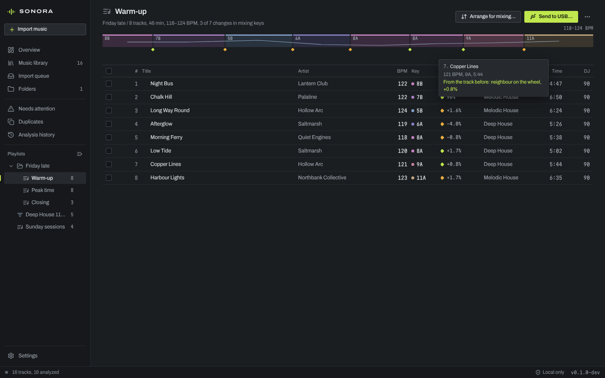
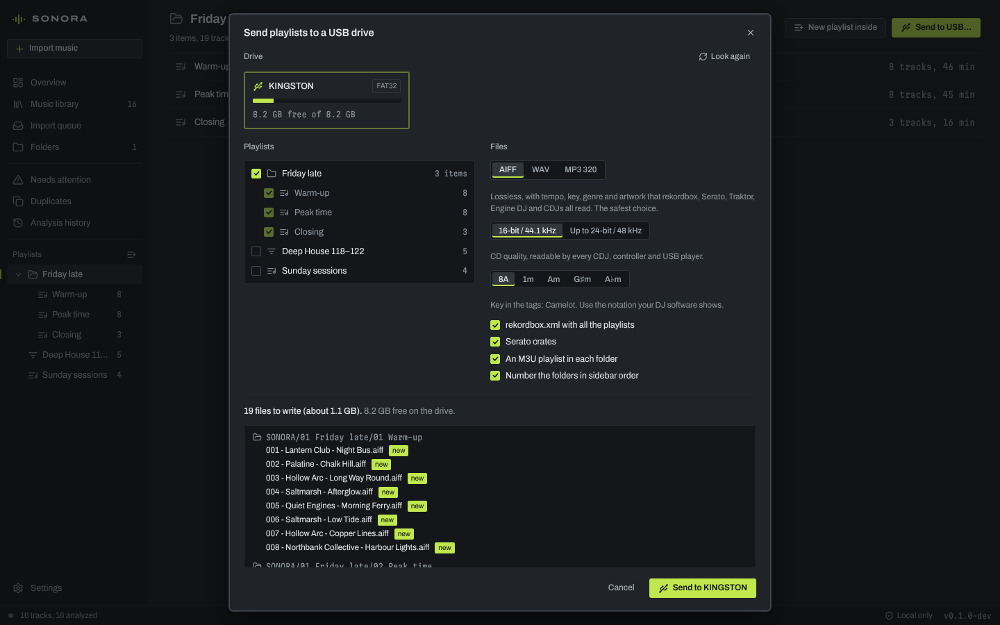

# Playlists and USB drives

SONORA sorts your tracks into playlists and folders, shows each playlist as
a set (keys, tempo and how every change mixes), suggests a running order
for mixing, and sends playlists to a USB drive as folders of DJ-ready files
with playlists for rekordbox, Serato and other DJ software.

Playlists only refer to tracks in your library. Deleting a playlist never
deletes a track or a file, and your music folders are never changed.

- [Playlists, folders and smart playlists](#playlists-folders-and-smart-playlists)
- [A playlist as a set](#a-playlist-as-a-set)
- [Arrange for mixing](#arrange-for-mixing)
- [Sort the library into playlists](#sort-the-library-into-playlists)
- [Send to USB](#send-to-usb)
- [Limits](#limits)



## Playlists, folders and smart playlists

The playlists are in the sidebar, under **Playlists**. The **+** button
beside the heading makes a playlist, a smart playlist or a folder. A new
playlist or folder has its name ready to type: type it and press Enter.

- A **playlist** holds tracks in the order you give them, each track once.
- A **folder** holds playlists, smart playlists and other folders.
- A **smart playlist** lists the library's tracks that match its rules, in
  the order the rules give, and keeps up by itself as tracks are added,
  analyzed or edited.

To put tracks in a playlist:

- Drag them from the library, or from another playlist, onto the playlist
  in the sidebar. Dragging one of the selected rows drags the whole
  selection.
- Or select them and choose **Add to playlist** in the details panel (or
  the selection bar), then the playlist. **New playlist of …** makes a new
  playlist of them.

A track that is already in the playlist is not added a second time. The
details panel lists the playlists that hold the track shown.

In a playlist, drag rows to change the order, or select them and press
**Alt+↑** or **Alt+↓**. **Delete** takes the selected tracks out of the
playlist (they stay in the library); **Undo** in the message that follows
puts them back where they were. Removing a track from the library, or
moving its file to the Trash, also takes it out of every playlist; the
question before it names those playlists.

In the sidebar, drag playlists and folders to change their order, or drop
them onto a folder to put them inside it. Each one has a menu (the **⋯**
button, or right-click) with **Rename**, **Duplicate**, **Send to USB…** and
**Delete…**; folders also make new playlists and folders inside themselves.
Deleting asks first, and a folder's contents go with it.

### Smart playlists

**Save as smart playlist** in the library's filter bar makes a smart
playlist of the filters shown, or **+** → **New smart playlist…** starts
from nothing. The rules:

- words in the title, artist, album, genre or file name;
- a tempo range, with *Also half and double tempo* if you want;
- keys, picked on the Camelot wheel, with *Include keys that mix with
  these* if you want;
- genres;
- a lowest DJ score: 55, 75 or 90;
- the order: tempo, key, title, artist, DJ score or date added, rising or
  falling (filters saved from the library keep the library's order, and the
  window names it);
- at most a number of tracks (up to 10,000).

Other library filters you saved with it (format, issue, status, folder, a
score range) are kept as they are, and the window lists them. A smart
playlist holds one score range, so choosing a DJ score replaces a saved
one. **Edit rules…** changes the rules at any time, and **Convert to a
playlist** turns a smart playlist into an ordinary playlist of what it lists
now, which you can then order by hand. Converting asks first, because the
rules are not kept: **Duplicate** it before converting to keep both.

### Keyboard

| Where | Keys |
| --- | --- |
| The playlists in the sidebar | **↑** **↓** move between them, **→** **←** open and close folders, **Enter** opens, **F2** renames, **Delete** deletes, **Alt+↑** **Alt+↓** move a playlist among its neighbours, **Alt+→** moves it into the folder above it and **Alt+←** out of its folder, **Shift+F10** opens its menu |
| The tracks of a playlist | **↑** **↓** move (with **Shift** to select), **Space** selects, **Ctrl+A** (**⌘A**) selects all, **Alt+↑** **Alt+↓** move the selected tracks, **Delete** takes them out, **P** plays, **Enter** opens the track's analysis, **Shift+F10** opens the track's menu (as a right-click does) |

## A playlist as a set

A playlist opens with its set at a glance: one block per track, as long as
the track and tinted by its key's place on the Camelot wheel, with the tempo
as a line across. A diamond under each change shows how the two keys mix.
The track playing shows its position. Point at a block to see the track and
how it mixes in from the one before; click it to select the track.

The **Mix in** column says the same for each track:

| Mark | The keys | For example |
| --- | --- | --- |
| Lime | The same key, the relative key (same number, other letter), or one step round the wheel | 8A to 8A, 8A to 8B, 8A to 9A |
| Amber | One step round and the other letter, or two steps round: these work with care | 8A to 9B, 8A to 10A |
| Red | The keys clash | 8A to 3B |
| Grey | A key is not known | |

Beside the mark is the tempo change, in percent. Mixing at half or double
time counts when it is closer (shown as ½×2): 87 BPM into 172 BPM is a 1.1 %
change. The heading sums it up: how many changes are in keys that mix.

## Arrange for mixing

**Arrange for mixing…** (for playlists of 3 to 1,000 tracks) suggests a
running order: neighbours in keys that mix, and close in tempo. It shows the
set as it is and as arranged, one above the other, with the changes in keys
that mix, the key clashes and the average tempo change, before and after.
Nothing changes until you choose **Use this order**, and you can still move
tracks by hand afterwards.

- **Keep "…" first** keeps your opener.
- **Build up: slower tracks first** lets the tempo rise through the set.

How it works: each change from one track to the next has a cost. The same
key costs nothing; the relative key or a neighbour on the wheel costs a
little; the amber moves cost more, and a clash a lot. Tempo changes cost
little up to 1 %, more up to 6 % and steeply beyond, and mixing at half or
double time adds a little. A key or tempo that is not known costs about as
much as an amber move, so those tracks end up where they do the least harm.
SONORA builds an order from every possible opener (up to 150 tracks), each
time going on to the cheapest next track, keeps the cheapest, and then
improves it by moving single tracks elsewhere and reversing stretches of the
set while that lowers the total. With *Build up*, a slower next track costs
extra, and stretches are not reversed.

## Sort the library into playlists

**+** → **Sort library into playlists…** makes a new folder with one
playlist per genre, per key or per tempo band of 5 BPM ("120–124 BPM"),
slowest tracks first in each. With *Keep them up to date* they are smart
playlists, so new and changed tracks move in by themselves. A playlist's
**⋯** → **Sort these into playlists…** does the same for its own tracks, as
ordinary playlists.

Tracks without a genre, key or tempo stay out, and the message says how
many. One folder holds at most 200 playlists.

## Send to USB

**Send to USB…** (on a playlist, a folder or in the **+** menu) copies
playlists to a USB drive as files that DJ software and players read with
their tempo, key, genre and artwork.



1. Choose the drive. SONORA lists connected external and removable drives
   with their free space; **Send to a folder…** sends somewhere else
   instead.
2. Choose the playlists. A folder takes everything inside it.
3. Choose the files: AIFF, WAV or MP3 320, the quality, and the key
   notation for the tags, as for [Export for DJ software](DJ.md#export-for-dj-software).
   The best copy of each recording is used.
4. Check what will happen: the files to write, move or keep, whether they
   fit, and the folders and files as they will be on the drive.
5. **Send to …**. The drive must stay connected until SONORA says it is
   done. You can close the window meanwhile; the status bar shows the
   progress, and **Stop** in the window stops it.

On the drive, everything goes into a `SONORA` folder, with a folder for each
playlist, inside folders as in the sidebar:

```
SONORA/
  01 Friday late/
    01 Warm-up/
      001 - Saltmarsh - Low Tide.aiff
      002 - Hollow Arc - Glass Steps.aiff
      Warm-up.m3u8
    02 Peak time/
      …
  rekordbox.xml
_Serato_/Subcrates/SONORA%%01 Friday late%%01 Warm-up.crate
```

- Folders are numbered in sidebar order, and files in playlist order, so a
  CDJ, an XDJ or a controller browsing the drive lists the set in the order
  you made it. *Number the folders in sidebar order* turns the folder
  numbers off.
- *An M3U playlist in each folder* writes the playlist for Engine DJ,
  Traktor, VirtualDJ and most other software.
- *rekordbox.xml with all the playlists* writes one file with every
  playlist sent to the drive, in its folders.
- *Serato crates* go into the drive's `_Serato_` folder, where Serato DJ
  finds them when the drive is connected. They need the top of a drive, so
  they are not written when you send to a folder.
- Names are shortened to 60 characters for folders and 100 for files, and
  characters that drives cannot store are replaced.

### Sending again

Sending the same playlists again brings the drive up to date. Files that
have not changed stay as they are, tracks that moved in the playlist are
renamed to their new number, and a file is written again when its source,
the format, or its title, artist, album, genre, tempo or key changed.

SONORA keeps a record of the files it wrote, in `SONORA/.sonora-sync.json`,
and only ever renames, replaces or removes those files, and only while they
are exactly as it left them. Anything else on the drive is never touched:
when a name SONORA wants is taken by a file of yours, its file gets another
name.

Tracks taken out of a playlist, and playlists you delete in SONORA, leave
their files on the drive until you tick *Remove the … files SONORA put
there for tracks no longer in these playlists, or for playlists you
deleted* on a later send. A deleted playlist's M3U playlist and Serato
crate go at the next send without asking, so DJ software does not list a
playlist that no longer exists, and rekordbox.xml stops listing it.

Before sending, SONORA checks that the files fit (with 64 MB to spare), and
that no file is 4 GB or larger on a FAT32 drive, which cannot hold such
files. Tracks whose files are missing are left out, and the window says so.

### Using the drive

- **CDJs, XDJs, controllers and other players**: browse the drive's folders.
- **rekordbox**: in Preferences → Advanced → Database, choose
  `SONORA/rekordbox.xml` on the drive under *rekordbox xml*. The playlists
  appear under *rekordbox xml* in the tree: right-click one and choose
  **Import Playlist**. To give CDJs waveforms and cue points, export the
  playlists to the drive from rekordbox afterwards.
- **Serato DJ**: the crates appear under the drive when it is connected.
- **Engine DJ, Traktor, VirtualDJ**: open the M3U file in a playlist's
  folder, or add the folder to the collection.

Eject the drive in Finder or File Explorer before unplugging it.

## Limits

- A playlist holds up to 10,000 tracks, and a smart playlist lists up to
  10,000. Names are up to 120 characters.
- Arranging is a suggestion from keys and tempos alone. It does not hear
  energy, vocals or mood. It works on playlists of up to 1,000 tracks, and
  with more than 150 it does not try every opener: it starts with your
  first track (with *Build up*, the slowest).
- The drive gets files and playlists, not beat grids, cue points or
  waveforms: rekordbox, Serato and the others compute and store those
  themselves.
- The rekordbox.xml and Serato crates describe the drive. rekordbox reads
  the xml when you import it, so later sends need a new import.
